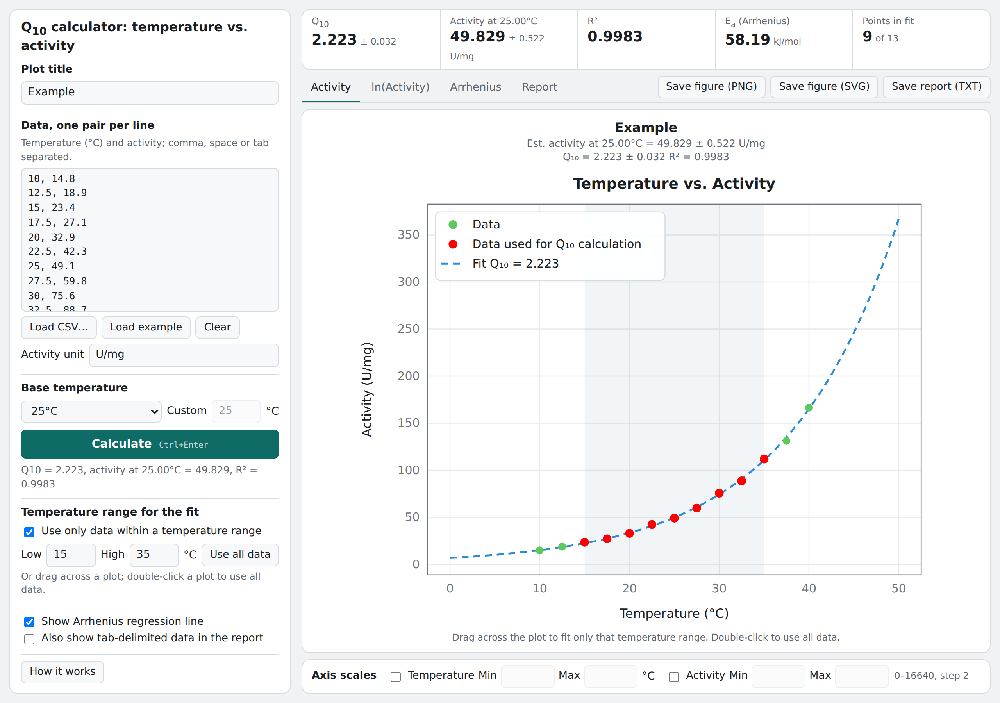
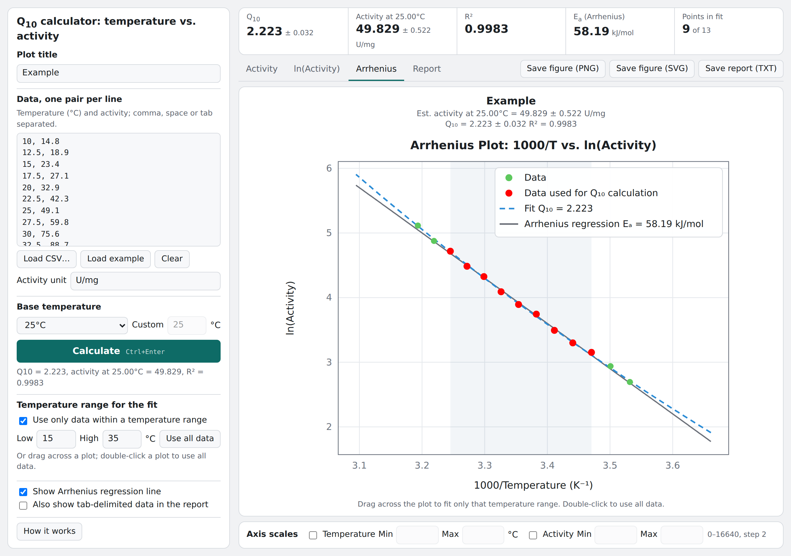

# Q10 calculator: temperature vs. activity

Fit a Q<sub>10</sub> temperature coefficient to activity measured at several temperatures, and see the fit on Activity, ln(Activity) and Arrhenius plots.

**Web app:** https://dxda6216.github.io/q10_temperature_vs_activity/

[](https://dxda6216.github.io/q10_temperature_vs_activity/)

The calculator comes in two versions that give the same results:

| File | Version | How to run |
|---|---|---|
| [`index.html`](index.html) | Web app (single HTML file) | Open the [web app](https://dxda6216.github.io/q10_temperature_vs_activity/), or download `index.html` and open it in a browser. Works offline; no installation or server needed ([details](#web-app-online-and-offline-use)). |
| [`q10_temperature_vs_activity.py`](q10_temperature_vs_activity.py) | Desktop app (Python / Tkinter) | `python q10_temperature_vs_activity.py` |

## Features

- Paste temperature–activity pairs or load a CSV file.
- Non-linear least-squares fit of Q<sub>10</sub> and the activity at a base temperature of your choice, with standard errors and R².
- Three plots: Activity vs. temperature, ln(Activity) vs. temperature, and an Arrhenius plot (ln(Activity) vs. 1000/T) with an optional Arrhenius regression line and activation energy E<sub>a</sub>.
- Fit only part of the data: set a temperature range, or drag across any plot with the mouse. Double-click a plot to go back to all data.
- Manual axis scales for temperature and activity.
- Save the three plots as one image (web: PNG or SVG; desktop: PNG, PDF or SVG) and the results as a text report.
- Starts with a demo calculation on example data.
- Runs entirely on your computer; the web app also works offline as a downloaded HTML file.

The Arrhenius plot with the Arrhenius regression line, using the same 15–35 °C range:



## Model

The activity A at temperature T (°C) is modelled as

```
A(T) = A_b · Q10 ^ ((T − T_b) / 10)
```

where A<sub>b</sub> is the activity at the base temperature T<sub>b</sub>. Taking logarithms gives a straight line in T:

```
ln A(T) = ln A_b + ((T − T_b) / 10) · ln Q10
```

Q<sub>10</sub> > 1 means the activity rises with temperature, Q<sub>10</sub> = 1 means no temperature dependence, and Q<sub>10</sub> < 1 means the activity falls as temperature rises. Typical enzyme-catalysed reactions have Q<sub>10</sub> of about 2 to 3.

The base temperature (0, 4, 20, 25, 30 or 37 °C, the minimum, maximum, average or median of the data, or a custom value) only decides at which temperature A<sub>b</sub> is reported. Q<sub>10</sub>, its standard error, R² and the fitted curve are the same for every choice.

## How the fit is calculated

- **Fit:** non-linear least squares on the activity itself (not its logarithm), minimising SSE = Σ (A<sub>i</sub> − Â<sub>i</sub>)². The desktop app uses SciPy's `curve_fit`; the web app uses the Levenberg–Marquardt method and reaches the same minimum.
- **Starting values:** a straight-line regression of ln(activity) on temperature.
- **Standard errors (±):** square roots of the diagonal of s² (JᵀJ)⁻¹ with s² = SSE / (n − 2), the same definition as `curve_fit` with `absolute_sigma=False`.
- **R²** = 1 − SSE / SST.
- **Arrhenius regression:** a straight line of ln(activity) against 1000/T<sub>K</sub> (T<sub>K</sub> in kelvin), fitted to the same data as Q<sub>10</sub>. The activation energy is E<sub>a</sub> = −slope × 1000 × R, with R = 8.314 J mol⁻¹ K⁻¹.

## Input data

Enter one pair per line: temperature in °C, then activity. Values can be separated by commas, spaces, tabs or semicolons. A header line and lines starting with `#` are skipped.

```
# temperature (°C), activity (U/mg)
10, 14.8
15, 23.4
20, 32.9
25, 49.1
30, 75.6
35, 111.9
40, 166.4
```

CSV files should have temperature in the first column and activity in the second. At least 3 data points are needed, and all activities must be positive. You can also enter the activity unit, which is used in the plot labels and the report.

## Temperature range for the fit

Tick **Use only data within a temperature range** and set Low and High, or drag across any plot after calculating. Points used in the fit are shown in red and points outside the range in green. Double-click a plot or click **Use all data** to return to all data. The automatic axis scales stay those of the all-data fit, so they do not jump when the range changes.

## Axis scales

The axes are scaled automatically. To set them yourself, tick **Temperature** and/or **Activity** under **Axis scales** (below the plot) and enter Min and Max. Press Enter, click the arrows or move to another field to apply; untick to return to automatic scaling.

| Axis | Range | Step of the arrows |
|---|---|---|
| Temperature | 0–100 °C | 0.5 °C |
| Activity | 0 to 100 × the largest activity in the data | Set from the data: data maximum / 50, rounded to 1, 2 or 5 × 10ⁿ |

The Arrhenius x axis is converted from the temperature range to 1000/T. The ln(Activity) and Arrhenius y axes are converted from the activity range to ln; with Min = 0 their lower limit stays automatic, because ln(0) is undefined.

## Web app: online and offline use

`index.html` is the whole web app in one file: all of its code and styles are inside it, and it needs no server, installation or internet connection to calculate.

### Use it online

Open https://dxda6216.github.io/q10_temperature_vs_activity/ in a browser.

### Download it and use it offline

1. Get `index.html` in one of these ways:
   - On GitHub, open [`index.html`](index.html) and click the **Download raw file** button (the download icon above the code), or
   - download the whole repository with **Code → Download ZIP** and unzip it, or
   - open the [web app](https://dxda6216.github.io/q10_temperature_vs_activity/) and save the page with **File → Save Page As…** (Ctrl+S / ⌘S), choosing **Webpage, HTML only** (Chrome/Edge) or **Web Page, HTML only** (Firefox).
2. Put the file anywhere you like, for example on your desktop or a USB stick. You can rename it (for example `q10_calculator.html`).
3. Double-click the file, or drag it into a browser window. It opens and runs without an internet connection.

Everything works offline: calculating, the plots, drag-to-select, axis scales, loading CSV files and saving the figure (PNG/SVG) and the report (TXT). Saved files go to the browser's usual download folder.

Notes:

- The page uses the IBM Plex fonts from Google Fonts when it is online. Offline, it falls back to your system fonts; only the look of the text changes, not the results.
- Use a current version of Chrome, Edge, Firefox or Safari.
- The downloaded file does not update itself. To get a newer version, download `index.html` again.
- Data you enter is not kept when you close or reload the page. Save the report, or keep your data in a CSV file and load it again.

## Desktop app: installation and usage

Requirements: Python 3.9 or later with numpy, scipy and matplotlib. Tkinter, which draws the window, is included with Python from python.org and with Anaconda/Miniconda.

First get the program: download [`q10_temperature_vs_activity.py`](q10_temperature_vs_activity.py), or download the whole repository (**Code → Download ZIP**), or clone it:

```
git clone https://github.com/dxda6216/q10_temperature_vs_activity.git
cd q10_temperature_vs_activity
```

### With Anaconda

Anaconda already includes numpy, scipy, matplotlib and Tkinter, so nothing needs to be installed.

1. Open **Anaconda Prompt** (Windows: Start menu) or a terminal (macOS / Linux).
2. Go to the folder that contains `q10_temperature_vs_activity.py`, for example:
   ```
   cd Downloads\q10_temperature_vs_activity      (Windows)
   cd ~/Downloads/q10_temperature_vs_activity     (macOS / Linux)
   ```
3. Run the program:
   ```
   python q10_temperature_vs_activity.py
   ```

### With Miniconda

Miniconda contains only Python and conda, so create an environment with the required packages once:

1. Open **Anaconda Prompt (Miniconda3)** (Windows: Start menu) or a terminal (macOS / Linux).
2. Create the environment (only the first time):
   ```
   conda create -n q10 python=3.12 numpy scipy matplotlib
   ```
   Answer `y` when conda asks to proceed. To use conda-forge packages instead, add `-c conda-forge`.
3. Activate the environment, go to the program's folder and run it:
   ```
   conda activate q10
   cd path/to/q10_temperature_vs_activity
   python q10_temperature_vs_activity.py
   ```

Each later time, only step 3 is needed. The same environment also works with Anaconda if you prefer to keep the program separate from the `base` environment. To remove it: `conda remove -n q10 --all`.

### With pip (Python from python.org)

```
pip install numpy scipy matplotlib
python q10_temperature_vs_activity.py
```

On macOS and Linux, use `python3` and `pip3` if `python` points to an older Python. On some Linux distributions Tkinter is a separate package (for example `sudo apt install python3-tk` on Debian/Ubuntu).

### Using the desktop app

1. The window opens with a demo calculation on example data. Click **Clear** to start with your own data.
2. Enter one temperature (°C), activity pair per line, or click **Load CSV...**. Enter the activity unit if you like.
3. Choose the base temperature and click **Calculate** (or press Ctrl+Enter).
4. Look at the **Results**, **Activity**, **ln(Activity)** and **Arrhenius** tabs. The toolbar below each plot zooms, pans and saves that single plot.
5. To fit only part of the data, drag across a plot, or tick **Use only data within a temperature range** and set Low and High. Double-click a plot or click **Use all data** to go back.
6. To set the axes yourself, use **Axis scales** below the plots.
7. **Save figure...** saves the three plots stacked in one image (PNG, PDF or SVG); **Save results...** saves the results as a text file.
8. **How it works** opens a window explaining the method.

### Troubleshooting

- **`ModuleNotFoundError: No module named 'numpy'`** (or scipy / matplotlib): the packages are not installed in the Python you are running. With Miniconda, run `conda activate q10` first; with pip, run the `pip install` line above.
- **`ModuleNotFoundError: No module named 'tkinter'`**: install Tkinter (Linux: `sudo apt install python3-tk`), or use Anaconda/Miniconda, which include it.
- **Spyder or Jupyter:** the program opens its own window, so run it from Anaconda Prompt or a terminal as shown above rather than inside Spyder's or Jupyter's console.
- **No installation possible:** use the [web app](https://dxda6216.github.io/q10_temperature_vs_activity/), which gives the same results in a browser.

The comment block at the top of `q10_temperature_vs_activity.py` describes the background, calculation method and usage in more detail.

## Privacy

All calculations run locally, in your browser or on your computer. The data you enter is not sent anywhere or stored. Files are written only when you use the save buttons.

## License

This project is released under the [MIT License](LICENSE).
